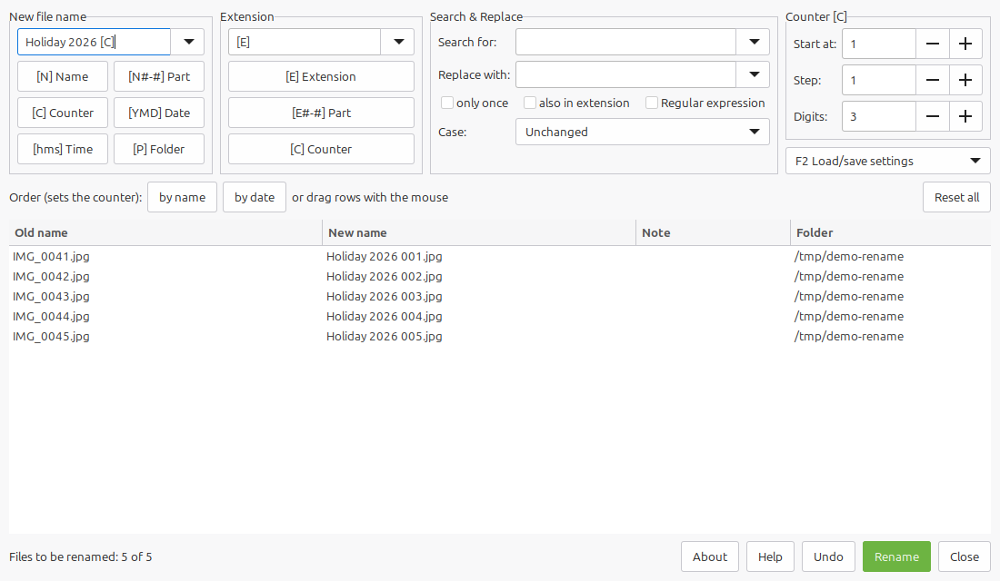

# Linux Speed Rename

A clear, intuitive tool for renaming a handful or a great many files that blends seamlessly into the Linux desktop.
Designed as a user-friendly integration for the Linux file manager **Nemo** (Linux Mint / Cinnamon) – inspired by the multi-rename tool of Total Commander. Tested with Nemo so far. The program can also be started from other file managers via “Open with”, but the F2 key and the context-menu entry are Nemo-specific.

Version 1.0.0 of 2026-11-21 · Programming: Paul Bittner · Licence: GNU GPL v3 or later

*Deutsch: [README.de.md](README.de.md)*

## How to use

When installed, start the file manager Nemo, mark the files you want to rename and press **F2**.



## Why?

The usual Linux bulk renamers are either too basic or look like an aircraft cockpit.
Here you build the new name from **building blocks** that you insert with a click – no programming knowledge needed:

| Block | Meaning | Example for `IMG_0042.jpg` |
|---|---|---|
| `[N]` | old name without extension | `IMG_0042` |
| `[N5-8]` | characters 5 to 8 of the old name | `0042` |
| `[N3-]` / `[N-4]` | from character 3 / the last 4 characters | `G_0042` / `0042` |
| `[E]` | extension | `jpg` |
| `[C]` | running counter (start, step, digits adjustable) | `001` |
| `[YMD]` | modification date | `2026-10-03` |
| `[Y]` `[M]` `[D]` | year, month, day | `2026` `10` `03` |
| `[hms]` | modification time | `14-05-09` |
| `[P]` | name of the folder | `Holiday` |

**Example:** mask `2026-10 Photo [C]`, counter with 3 digits → `2026-10 Photo 001.jpg`, `2026-10 Photo 002.jpg`, …

Also:

- **Live preview** of all new names. Conflicts (duplicate or already existing names) are shown in red – then nothing is renamed.
- **Select a part with the mouse:** the “[N#-#] Part” button shows the first file name, you simply select the part you want to keep.
- **Search & Replace**, optionally only once, including the extension, or as a regular expression.
- **Change case** (lower, UPPER, Title …).
- **Order** (sets the counter): sort by name or date, or drag rows with the mouse.
- **History:** recently used masks in the drop-down.
- **Saved settings (F2):** store all fields under a name and load them again later – see below.
- **Regular expressions** with `$1`, `$2` … like in Total Commander – see the simple examples below.
- **Undo** – even after restarting the program.
- **Safe:** renaming happens in two steps via temporary names, so swapping names (A↔B) works, and on any error everything is rolled back.
- **Languages:** English, German, French, Spanish, Italian, Dutch, Polish, Portuguese – picked automatically from the system language.

Keyboard: `Ctrl+Enter` rename, `F1` help, `F2` saved settings, `Esc` close. The **About** button shows version, author and licence (`--version` on the command line).

## Saved settings (F2)

Complicated setups do not have to be typed again. The drop-down **“F2 Load/save settings”** (below the counter) saves *all* fields – masks, search & replace, options, counter – under a name of your choice:

- **Save settings …** – store the current fields (enter a new name or pick an existing one to overwrite it).
- Pick a saved name – all fields are filled in again.
- **Delete entry …** – remove the currently loaded settings.
- **&lt;Default&gt;** – back to the plain starting values.

Press **F2** in the window to open the list. The settings are stored in `~/.config/linux-speed-rename/` (see below).

## Regular expressions – simple examples

You never *need* regular expressions, but they help when names follow a fixed pattern and you want to rearrange parts of them.
Tick **“Regular expression”** and use these building blocks in **Search for**:

| Write | Means |
|---|---|
| `\S+` | a word without spaces (e.g. `K733142`) |
| `\d` / `\d+` | one digit / one or more digits |
| `.*` | any text (also empty) |
| `^` / `$` | start / end of the name |
| `\.` `\(` `\)` | a real dot, a real bracket (otherwise they have a special meaning) |
| `( … )` | **remember** this part … |
| `$1`, `$2` … | … and insert it again in **Replace with** (1st bracket, 2nd bracket …) |

**Examples** (the extension, e.g. `.jpg`, stays untouched unless “also in extension” is ticked):

| Task | Search for | Replace with | Before → after |
|---|---|---|---|
| Tidy up a drawing export | `^(\S+) - (\S+) - (\S+) - (.*)$` | `$1-$2.$3.$4` | `K733142 - EN - 1 - - Drawing Object` → `K733142-EN.1.- Drawing Object` |
| Turn a date round | `^(\d\d)\.(\d\d)\.(\d{4})` | `$3-$2-$1` | `03.10.2026 Invoice` → `2026-10-03 Invoice` |
| Swap two words | `^(\S+) (\S+)$` | `$2 $1` | `Smith John` → `John Smith` |
| Remove a bracket and its content | ` ?\(.*?\)` | *(empty)* | `Photo (copy)` → `Photo` |
| Remove a leading track number | `^\d+\s*-\s*` | *(empty)* | `07 - Song` → `Song` |
| Underscores and multiple spaces → one space | `[ _]+` | ` ` *(one space)* | `My__holiday   2026` → `My holiday 2026` |

How the first example works: `^(\S+) - (\S+) - (\S+) - (.*)$` reads *“at the start a word (1), then ` - `, a word (2), ` - `, a word (3), ` - `, and the rest up to the end (4)”*. The replacement `$1-$2.$3.$4` glues the four remembered parts together with `-`, `.` and `.`.

Tip: watch the **preview** while typing – it shows the result at once. Save a pattern you need again with **F2 → Save settings …**.

## Installation

Requires Python 3 and GTK 3 (pre-installed on Linux Mint; otherwise `sudo apt install python3-gi gir1.2-gtk-3.0`).

```sh
git clone <repo-url> linux-speed-rename
cd linux-speed-rename
./install.sh
```

The installer works for your user only (into `~/.local`), needs no root rights, and **integrates the tool into Nemo automatically**:

1. **F2 with several files selected** opens Linux Speed Rename (Nemo setting `bulk-rename-tool`; the previous value is saved).
2. **Right-click menu** gets the entry “Linux Speed Rename …”.
3. A **start menu entry** is created.

If the right-click entry does not show up straight away, restart Nemo once: `nemo -q`.

### Uninstall

```sh
./uninstall.sh
```

This also restores Nemo's previous rename tool. Your settings in `~/.config/linux-speed-rename` stay.

### Manual integration into Nemo (optional)

`install.sh` does this for you. If you want to do it by hand, or use the tool from another location:

```sh
# F2 with several files selected
gsettings set org.nemo.preferences bulk-rename-tool "b'/path/to/linux-speed-rename'"

# back to the previous tool (e.g. on Linux Mint 22)
gsettings reset org.nemo.preferences bulk-rename-tool
```

For the right-click entry, copy `nemo/linux-speed-rename.nemo_action` to `~/.local/share/nemo/actions/` and replace `@LAUNCHER@` with the path to the program.

### Try without installing

```sh
python3 -m linux_speed_rename FILE …
```

## Languages

The language follows the desktop's system language (`LANGUAGE`, `LC_ALL`, `LC_MESSAGES`, `LANG`). If there is no translation, British English is used.
To test another language: `LINUX_SPEED_RENAME_LANG=fr python3 -m linux_speed_rename FILE …`

The initial translations were machine-assisted. **Corrections by native speakers are very welcome.**

### Adding or improving a translation

Texts are in standard gettext files – any `.po` editor (e.g. Poedit) works:

1. Copy `linux_speed_rename/locale/messages.pot` to `linux_speed_rename/locale/<code>.po` (e.g. `sv.po`) and translate it.
2. Translate the help text `linux_speed_rename/help/en.txt` into `help/<code>.txt`.
3. Add `Name[<code>]` / `Comment[<code>]` lines to `nemo/*.nemo_action` and `desktop/*.desktop`.
4. Run the tests – they check that every text is translated and placeholders like `{n}` are kept.

No compilation step is needed; the program reads the `.po` files directly.

## Development

The renaming logic lives without any GUI in `linux_speed_rename/engine.py`, the window in `app.py`, translations in `i18n.py`.

```sh
python3 -m unittest discover -s tests -v
tools/update-translations.sh   # after changing texts in the code
```

Ideas and bug reports are welcome.

## Licence

Copyright © 2026 Paul Bittner

This program is free software: you can redistribute it and/or modify it under the terms of the GNU General Public License as published by the Free Software Foundation, either version 3 of the License, or (at your option) any later version. It is distributed in the hope that it will be useful, but WITHOUT ANY WARRANTY. See [LICENSE](LICENSE) for the full text.
